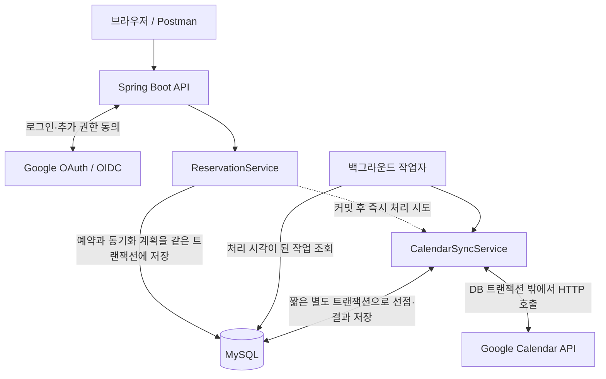
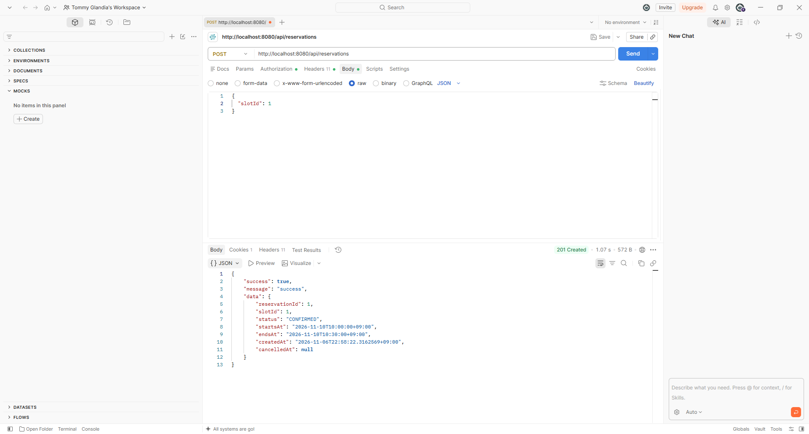
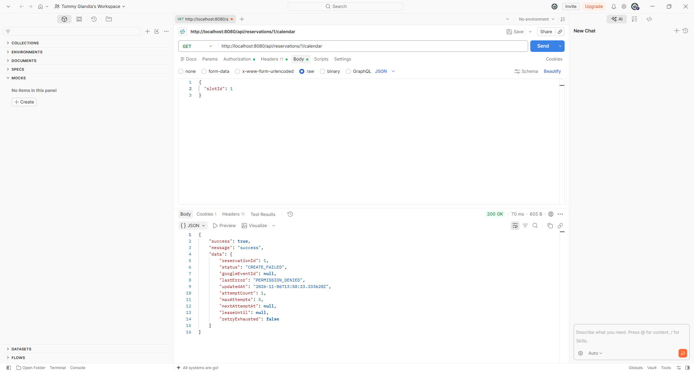
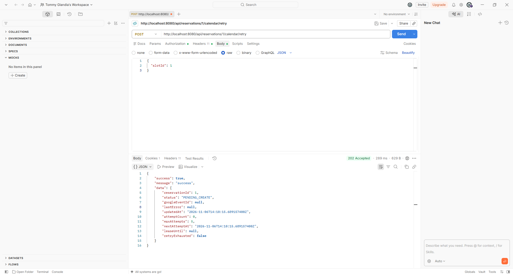
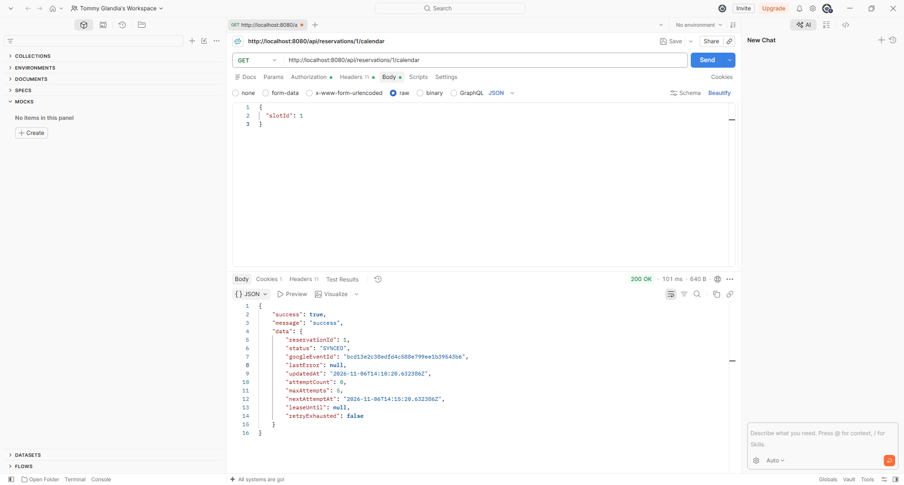
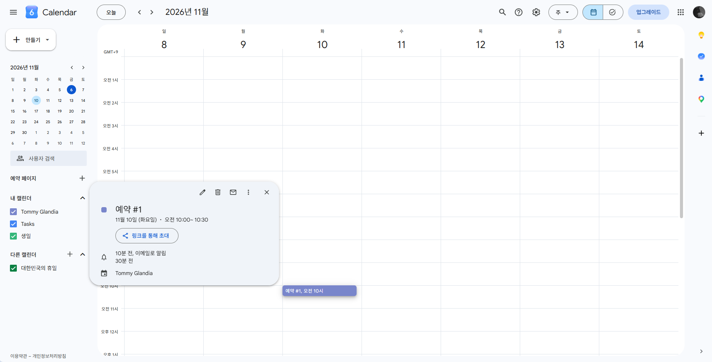
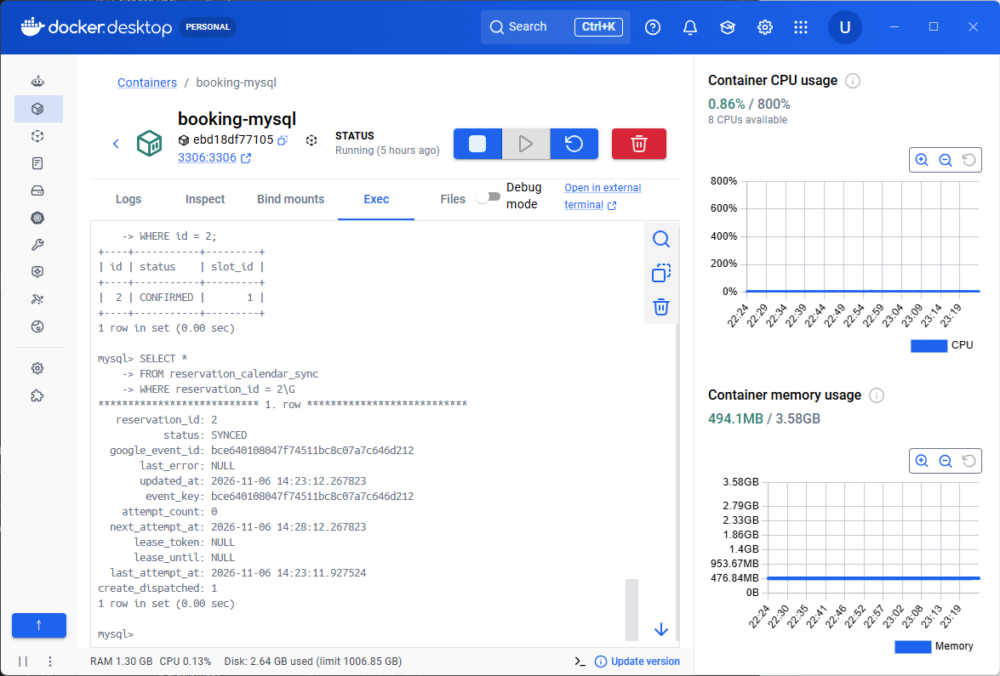

# Booking Calendar API

Google 계정으로 로그인한 사용자가 시간대를 예약하고, 예약 내역을 Google Calendar에 반영하는 개인 미니 프로젝트입니다.

기존 프로젝트에서 상대적으로 경험이 부족했던 외부 API 연동을 학습하기 위해 시작했습니다. 로그인과 예약 기능을 구현한 뒤, 동시에 같은 슬롯을 예약하거나 외부 API의 응답을 받지 못하는 상황까지 다뤄봤습니다. 특히 **DB에 예약이 저장되는 것과 Google Calendar에 일정이 생성되는 것은 별개의 결과**라는 점을 중심으로 설계했습니다.

## 1. 기술 스택

| 구분 | 사용 기술 |
| --- | --- |
| 개발 환경 | Java 21, Spring Boot 4.1.2, Gradle Wrapper 9.8.2 |
| 인증 | Spring Security, OAuth2 Client, OIDC, 세션 인증 |
| 데이터 저장 | Spring Data JPA, MySQL 8.4, Flyway |
| 외부 연동 | Spring RestClient, Google Calendar REST API |
| 테스트 | JUnit Jupiter, Spring Boot Test, Spring Security Test, H2, 로컬 모의 HTTP 서버 |

## 2. 주요 기능

- **로그인 및 회원 관리**: Google OIDC 로그인, 최초 회원 등록, 재로그인 시 프로필 갱신, 내 정보 조회와 로그아웃을 구현했습니다. 회원은 이메일 대신 `provider + sub`로 식별합니다.
- **Calendar 연결**: 일반 로그인과 캘린더 권한 동의를 분리했습니다. Access Token과 Refresh Token은 AES-256-GCM으로 암호화해 저장하고, 만료된 Access Token을 갱신합니다.
- **예약 관리**: 예약 가능한 날짜·시간대 조회, 예약 생성, 내 예약 목록 조회와 취소를 제공합니다. 하나의 슬롯에는 활성 예약을 최대 한 건만 허용하며, 본인의 예약만 취소할 수 있습니다.
- **일정 동기화**: 연결된 사용자의 기본 캘린더(`primary`)에 일정을 생성하고, 취소 시 삭제를 반영합니다. 연결 상태와 예약별 동기화 상태는 별도 API로 조회합니다.
- **실패 복구**: DB에 저장한 처리 일정에 따라 자동 재시도하고, 본인의 동기화 작업을 수동으로 재등록할 수 있습니다. 작업 선점과 정기 확인을 통해 중복 실행과 지연된 응답도 고려했습니다.

예약 시간은 DB에 UTC 기준으로 저장하고, 예약 API에서는 `Asia/Seoul` 기준의 오프셋 시각으로 반환합니다. 슬롯은 서버에서 미리 관리하며, 현재 슬롯 관리용 API나 별도 프론트엔드는 없습니다.

## 3. 시스템 아키텍처



예약 요청은 `Controller → ReservationApplicationService → ReservationService` 순서로 처리합니다. 슬롯에 잠금을 획득한 뒤 예약과 동기화 계획을 함께 저장하고 커밋합니다.

이후 `CalendarSyncService`가 외부 반영을 시도합니다. 작업 선점과 결과 저장에는 짧은 DB 트랜잭션을 사용하지만, Google 응답을 기다리는 동안에는 DB 트랜잭션을 유지하지 않습니다. 즉시 호출이 누락되거나 실패하더라도 백그라운드 작업자가 DB의 미완료 작업을 이어서 처리합니다.

따라서 예약 상태가 `CONFIRMED`여도 캘린더는 아직 `PENDING_CREATE` 또는 `CREATE_FAILED`일 수 있습니다. 예약 성공 여부와 외부 반영 여부를 각각 확인하도록 구성했습니다.

## 4. 핵심 기술적 문제 해결

### 같은 슬롯에 여러 예약 요청이 들어오는 경우

예약 가능 여부를 조회한 뒤 저장하는 방식만으로는 동시 요청을 막기 어렵습니다. 두 요청이 모두 비어 있는 슬롯을 조회할 수 있기 때문입니다. 이번에는 경쟁 대상이 명확한 슬롯 행에 **비관적 락(`PESSIMISTIC_WRITE`)**을 적용해 같은 슬롯의 예약·취소를 순서대로 처리했습니다. 잠금 획득 이후에는 `READ_COMMITTED`에서 최신 커밋 상태를 확인합니다.

애플리케이션의 잠금과 별개로 DB에도 `active_slot_id`의 UNIQUE 제약을 적용했습니다. 확정된 예약은 슬롯 ID를 보관하고, 취소하면 이 값을 `NULL`로 변경합니다. 이를 통해 취소 이력을 남기면서 같은 슬롯을 다시 예약할 수 있도록 했습니다. 8명의 동일 슬롯 예약 요청을 3회 반복한 테스트에서는 매번 1명만 성공하고, DB의 활성 예약도 한 건인 것을 확인했습니다.

관련 코드: [ReservationService](src/main/java/org/example/github_api_practice/reservation/ReservationService.java), [V2 마이그레이션](src/main/resources/db/migration/V2__create_reservations.sql)

### 예약 저장과 Google API 호출의 결과가 다른 경우

Google API 응답을 기다리는 동안 DB 잠금을 유지하면 다른 예약 요청까지 지연될 수 있습니다. 또한 MySQL 트랜잭션을 롤백하더라도 Google에서 이미 생성한 일정을 함께 되돌릴 수는 없습니다.

따라서 예약과 동기화 계획을 먼저 커밋하고 외부 API는 그 이후에 호출하도록 분리했습니다. 외부 호출이 실패하면 예약은 유지하고 동기화 실패를 기록합니다. 테스트에서도 HTTP 호출 시 DB 트랜잭션이 활성화되어 있지 않은지, 동기화 실패 이후 예약이 유지되는지 확인했습니다.

관련 코드: [ReservationApplicationService](src/main/java/org/example/github_api_practice/reservation/ReservationApplicationService.java), [CalendarSyncPlanner](src/main/java/org/example/github_api_practice/calendar/CalendarSyncPlanner.java)

### 일정은 생성됐지만 응답을 받지 못한 경우

생성 요청이 타임아웃됐다고 해서 Google의 처리까지 실패했다고 단정할 수는 없습니다. 이때 새로운 ID로 다시 생성하면 일정이 중복될 수 있습니다.

신규 동기화 계획을 저장할 때 고정 이벤트 키를 생성하고, 재시도에서도 같은 Google 이벤트 ID를 사용하도록 했습니다. 생성 전에 해당 ID를 조회하고, 기존 일정이 있다면 서비스의 소유 표식과 예약 시각을 검증해 결과를 재사용합니다. `409` 충돌에서도 같은 ID를 다시 조회합니다. 모의 서버에서 생성 이후 응답 유실·읽기 타임아웃을 재현해 추가 생성 없이 복구되는 것을 확인했습니다. 다만 이 방식을 외부 시스템을 포함한 완전한 Exactly-Once 보장으로 설명하지는 않습니다.

관련 코드: [GoogleCalendarClient](src/main/java/org/example/github_api_practice/calendar/GoogleCalendarClient.java)

### 작업이 중단되거나 여러 작업자가 동시에 처리하는 경우

메모리에만 재시도 정보를 두면 서버 중단 이후 처리할 작업을 잃을 수 있습니다. 이를 고려해 예약별 동기화 행에 시도 횟수, 다음 실행 시각과 작업 임대를 저장했습니다. 별도 이벤트 로그나 메시지 브로커를 추가하는 대신, 현재 예약 상태에 맞춰 처리하는 DB 기반 작업함으로 구성했습니다.

작업자는 기본 5초 간격으로 최대 20개의 후보를 조회합니다. 실제 선점 시에는 임대 토큰과 만료 시각을 저장하고, 결과를 기록할 때도 토큰이 같은지 검사합니다. 임대가 만료돼 다른 작업자가 이어받았다면 이전 작업자의 늦은 결과는 DB에 반영하지 않습니다.

일시적인 통신 오류·5xx·호출 제한은 대기 후 다시 시도하고, 재동의나 권한 오류 등은 자동 처리를 중단합니다. 기본 설정에서는 **최초 실행을 포함해 처리 주기당 최대 5회** 시도하며, 지수 대기와 무작위 지연을 적용합니다. `Retry-After`도 반영합니다. 또한 동기화 완료·삭제 확인 이후에는 기본 5분 간격으로 실제 상태를 확인해 늦게 생성된 취소 일정 등을 정리합니다. 기존 일정의 소실이나 시각 변경은 자동으로 덮어쓰지 않고 오류로 기록합니다.

관련 코드: [CalendarSyncStore](src/main/java/org/example/github_api_practice/calendar/CalendarSyncStore.java), [CalendarSyncWorker](src/main/java/org/example/github_api_practice/calendar/CalendarSyncWorker.java)

각 설계의 비교와 구현 과정은 아래 [개발 기록](#9-개발-기록)에 정리했습니다.

## 5. 주요 API와 사용 예시

### 인증과 요청 조건

브라우저에서 `/oauth2/authorization/google`로 접속해 로그인합니다. 이후 같은 로그인 세션에서 `/oauth2/authorization/google-calendar`로 접속하면 캘린더 권한을 연결할 수 있습니다. 추가 연결은 로그인한 Google 계정과 동일한 계정만 허용합니다.

API 인증에는 `JSESSIONID` 세션 쿠키를 사용합니다. 아래 표의 API는 `/api/health`, `/api/csrf`를 제외하고 로그인이 필요하며, **모든 POST 요청에는 CSRF 토큰도 필요**합니다. 로그인 이후 `GET /api/csrf`의 `data.headerName`과 `data.token`을 확인하고, 해당 이름의 요청 헤더에 토큰을 넣습니다. Postman을 사용할 때도 브라우저 로그인 세션과 요청 세션을 일치시켜야 합니다.

| Method | 경로 | 기능 |
| --- | --- | --- |
| GET | `/api/health` | 상태 확인 |
| GET | `/api/me` | 내 회원 정보 |
| GET | `/api/csrf` | CSRF 헤더 이름과 토큰 |
| POST | `/api/logout` | 로그아웃 |
| GET | `/api/reservation-slots/dates?from=YYYY-MM-DD&to=YYYY-MM-DD` | 예약 가능한 날짜 |
| GET | `/api/reservation-slots?date=YYYY-MM-DD` | 해당 날짜의 예약 가능한 슬롯 |
| POST | `/api/reservations` | 예약 생성 |
| GET | `/api/reservations?page=0&size=20` | 내 예약 목록 |
| POST | `/api/reservations/{id}/cancel` | 내 예약 취소 |
| GET | `/api/calendar/connection` | 캘린더 연결 상태 |
| GET | `/api/reservations/{id}/calendar` | 내 예약의 동기화 상태 |
| POST | `/api/reservations/{id}/calendar/retry` | 내 동기화 작업 재등록 |

오늘 이전 날짜는 조회할 수 없으며, 한 요청에서 조회하는 날짜 범위는 최대 31일입니다. 시작 시각이 되었거나 지난 슬롯은 예약·취소할 수 없습니다. 목록의 `page`는 0부터 시작하고 `size`는 1~100을 허용합니다.

### 예약 생성

`POST /api/reservations`의 요청 본문입니다. `slotId`는 슬롯 조회 응답에서 선택합니다.

```json
{
  "slotId": 1
}
```

응답 예시입니다. 아래 ID와 시각은 형식을 설명하기 위한 예시 값입니다.

```json
{
  "success": true,
  "message": "success",
  "data": {
    "reservationId": 1,
    "slotId": 1,
    "status": "CONFIRMED",
    "startsAt": "2026-11-10T10:00:00+09:00",
    "endsAt": "2026-11-10T10:30:00+09:00",
    "createdAt": "2026-11-07T09:00:00+09:00",
    "cancelledAt": null
  }
}
```

**HTTP 201 Created는 예약 생성 성공을 의미합니다.** Google 일정 생성 여부는 별도 상태 조회로 확인합니다. 이미 예약된 슬롯에는 `409 Conflict`와 `data.code: SLOT_ALREADY_RESERVED`를 반환합니다.

### 동기화 상태 조회와 수동 재등록

`GET /api/reservations/1/calendar`의 성공 상태 예시입니다. 동기화 관리 시각은 UTC(`Z`)로 반환됩니다.

```json
{
  "success": true,
  "message": "success",
  "data": {
    "reservationId": 1,
    "status": "SYNCED",
    "googleEventId": "bc0123456789abcdef0123456789abcdef",
    "lastError": null,
    "updatedAt": "2026-11-07T00:00:00Z",
    "attemptCount": 0,
    "maxAttempts": 5,
    "nextAttemptAt": "2026-11-07T00:05:00Z",
    "leaseUntil": null,
    "retryExhausted": false
  }
}
```

성공 이후 `attemptCount`는 초기화되며, `SYNCED`의 `nextAttemptAt`은 정기 확인 시각입니다. `CREATE_FAILED` 역시 Google에 일정이 없다는 뜻이 아니라, 생성 결과를 정상적으로 확정하지 못했다는 뜻입니다.

권한 등 원인을 확인한 뒤 `POST /api/reservations/1/calendar/retry`를 호출하면 처리 횟수를 초기화하고 작업을 다시 등록합니다. 요청 본문은 필요하지 않습니다. **HTTP 202 Accepted는 접수를 의미하며 동기화 완료를 의미하지 않습니다.** 후속 상태를 다시 조회해야 합니다. 활성 임대가 있으면 `409`, 타인의 작업이면 `403`으로 거부합니다.

## 6. 자동화 테스트와 검증 결과

| 환경 | 실행 결과 | 확인 범위 |
| --- | --- | --- |
| H2, MySQL 호환 모드 | 190개 통과, 실패·오류·건너뜀 0건 | 2026-11-07 현재 코드로 전체 재실행 |
| MySQL 8.4.13 | 188개 통과, 실패·오류·건너뜀 0건 | Chapter 4 완료 당시 보관한 실행 결과 |

현재 코드는 당시보다 OAuth 오류 처리 테스트가 2개 추가되어 있습니다. 위 MySQL 결과는 기존 188개 검증 기록이며, 현재 190개 전체를 MySQL에서 다시 실행한 결과는 아닙니다. 반복·매개변수 테스트의 실행 횟수를 포함한 수치입니다.

주요 테스트에서는 다음 상황을 확인했습니다.

- **예약 동시성**: 동일 슬롯에 8개 요청이 경쟁해도 활성 예약은 한 건만 저장됩니다. 서비스 잠금을 거치지 않은 중복 INSERT도 DB UNIQUE 제약으로 거부합니다.
- **응답 유실과 타임아웃**: 모의 서버가 일정을 생성한 뒤 응답 연결을 종료하거나 지연해도, 같은 ID를 조회하여 중복 생성 없이 복구합니다.
- **임대 만료와 중복 작업자**: 선점 상태를 남기고 시간을 이동시켜 새 작업자가 이어받도록 합니다. 오래된 토큰의 결과를 차단하고, 작업자 8개의 경쟁도 검증합니다.
- **예약 취소와 생성의 경합**: 취소 1건과 작업자 7개의 경쟁, 임대 만료 후 뒤늦게 생성된 일정의 정리를 확인합니다.
- **자동·수동 복구**: 오류별 재시도 여부, 대기 시각과 상한, 수동 재등록의 본인 확인·CSRF·활성 임대 검사를 검증합니다.
- **기존 기능 회귀**: 모의 OIDC 서버를 통한 로그인, 회원 저장, 세션·로그아웃, 토큰 암호화와 갱신을 함께 검증합니다.

이 테스트들은 로컬 모의 OAuth·Calendar 서버를 사용합니다. 작업 중단은 DB에 미완료 상태를 남기고 `Clock`과 새 작업자로 재현했으며, 실제 JVM 강제 종료나 여러 서버를 배포한 장시간 부하 테스트를 수행한 결과는 아닙니다.

## 7. 실제 Google Calendar 연동 검증

자동화 테스트와 별도로, 프론트엔드 없이 Postman과 실제 Google Calendar 웹페이지를 이용해 검증했습니다. 실제 Google 로그인 후 회원 정보를 조회했고, Calendar 연결 상태 `CONNECTED`와 Refresh Token 보유 여부 `true`를 확인했습니다. 토큰 보유 여부는 갱신 자체를 수동 검증한 결과와는 구분됩니다.

아래 첫 다섯 캡처는 **예약 1의 생성 → 동기화 실패 → 수동 재등록 → 동기화 완료 → 실제 일정 확인** 흐름입니다. 화면이 길어지지 않도록 각 캡처는 펼쳐서 볼 수 있게 정리했습니다.

<details>
<summary>1. 예약 생성 — 201 Created와 CONFIRMED</summary>

조회한 슬롯으로 예약을 생성했습니다. `201 Created`와 `CONFIRMED`는 예약 저장 성공을 의미하며, 이 응답만으로 Google 일정 생성까지 성공했다고 판단하지는 않았습니다.



</details>

<details>
<summary>2. 동기화 실패 기록 — CREATE_FAILED와 PERMISSION_DENIED</summary>

예약은 유지되었지만 캘린더 상태 조회에서는 `CREATE_FAILED / PERMISSION_DENIED`가 기록되었습니다. 예약 결과와 외부 반영 결과가 분리되어 있음을 확인했습니다. 이 캡처만으로 해당 권한 오류의 원인을 특정하지는 않았습니다.



</details>

<details>
<summary>3. 수동 재등록 접수 — 202 Accepted와 PENDING_CREATE</summary>

같은 예약의 수동 재등록 API를 호출해 `202 Accepted / PENDING_CREATE`를 확인했습니다. 이는 작업 재등록 접수이며, 외부 일정 생성 완료를 의미하지 않습니다.



</details>

<details>
<summary>4. 후속 동기화 완료 — SYNCED와 Google 이벤트 ID</summary>

후속 상태 조회에서 같은 예약이 `SYNCED`로 변경되고 `googleEventId`가 저장된 것을 확인했습니다. 실패 기록 이후 재등록과 동기화 완료는 확인했지만, 그 사이 권한 문제를 해결한 구체적인 조치는 이 캡처로 판단하지 않았습니다.



</details>

<details>
<summary>5. 실제 Google Calendar 일정 확인</summary>

Google Calendar에 표시된 `예약 #1`의 11월 10일 10:00~10:30 일정이 예약 생성 응답의 서울 기준 시각과 일치했습니다.



</details>

<details>
<summary>6. 별도 예약의 MySQL 저장 결과 확인</summary>

이 캡처는 위 복구 흐름과 다른 **예약 2**의 저장 검증입니다. MySQL 결과와 별도로 확인한 API 응답을 대조해 `SYNCED`, 이벤트 ID, 갱신 시각과 다음 확인 시각이 일치하는 것을 확인했습니다.



</details>

예약 취소 응답의 `CANCELLED`도 확인했습니다. 다만 이 결과만으로 실제 Google 일정 삭제까지 검증했다고 판단하지는 않았습니다. 실제 프로세스를 강제로 종료한 뒤 재시작해 자동 복구되는 과정 역시 별도 검증이 필요합니다.

## 8. 로컬 실행

Java 21과 MySQL이 필요합니다. 아래 명령은 **PowerShell 7 기준**이며, Docker는 로컬 MySQL을 실행하는 선택지입니다. 기존 MySQL을 사용하는 경우 컨테이너 실행은 생략할 수 있습니다.

### MySQL 준비

프로젝트 루트의 같은 터미널에서 실행합니다. 아래 비밀번호 입력값은 로컬에서 직접 정합니다.

```powershell
$env:DB_USERNAME = "booking_app"
$env:DB_PASSWORD = Read-Host "로컬 DB 비밀번호"
docker run --name booking-calendar-mysql -d `
  -p 127.0.0.1:3306:3306 `
  -e MYSQL_RANDOM_ROOT_PASSWORD=yes `
  -e MYSQL_DATABASE=booking_calendar `
  -e "MYSQL_USER=$env:DB_USERNAME" `
  -e "MYSQL_PASSWORD=$env:DB_PASSWORD" `
  -v booking-calendar-mysql-data:/var/lib/mysql `
  mysql:8.4 --character-set-server=utf8mb4 --collation-server=utf8mb4_bin
```

MySQL이 초기화를 마친 뒤 애플리케이션을 실행합니다. DB 테이블은 시작 시 Flyway의 V1~V4 마이그레이션으로 생성·검증합니다.

### Google 설정과 환경변수

Google Cloud 프로젝트에서 Calendar API를 활성화하고 OAuth 동의 화면을 설정합니다. 테스트 상태라면 사용할 계정을 테스트 사용자로 등록합니다. OAuth 클라이언트 유형은 웹 애플리케이션으로 선택하고, 로컬 기본 주소를 사용할 경우 다음 리디렉션 URI 두 개를 등록합니다.

```text
http://localhost:8080/login/oauth2/code/google
http://localhost:8080/login/oauth2/code/google-calendar
```

로그인은 `openid`, `profile`, `email`을 사용하고, Calendar 연결에서 `https://www.googleapis.com/auth/calendar.events.owned`를 추가 요청합니다. 설정 배경은 Google의 [웹 서버 OAuth 안내](https://developers.google.com/identity/protocols/oauth2/web-server)와 [Calendar API 활성화 안내](https://developers.google.com/workspace/calendar/api/quickstart/java#enable_the_api)를 참고할 수 있습니다.

| 환경변수 | 용도 |
| --- | --- |
| `DB_USERNAME`, `DB_PASSWORD` | MySQL 접속 정보, 필수 |
| `GOOGLE_CLIENT_ID`, `GOOGLE_CLIENT_SECRET` | 발급받은 OAuth 클라이언트 정보, 필수 |
| `CALENDAR_TOKEN_ENCRYPTION_KEY` | 32바이트 난수의 Base64 값, Calendar 기능 사용 시 필수 |
| `DB_URL` | 기본값은 아래 JDBC URL |
| `CALENDAR_SYNC_WORKER_ENABLED` | 백그라운드 처리 활성화, 기본 `true` |
| `SESSION_COOKIE_SECURE` | 기본 `false`, HTTPS 환경에서는 `true`로 설정 |

```powershell
$env:DB_URL = "jdbc:mysql://localhost:3306/booking_calendar?connectionTimeZone=UTC&forceConnectionTimeZoneToSession=true"
$env:GOOGLE_CLIENT_ID = Read-Host "Google Client ID"
$env:GOOGLE_CLIENT_SECRET = Read-Host "Google Client Secret"
```

암호화 키는 최초 한 번 생성해 안전한 곳에 보관하고, 이후 실행에도 같은 값을 사용합니다. 실행할 때마다 새 키로 바꾸면 기존 토큰을 복호화할 수 없습니다.

```powershell
$env:CALENDAR_TOKEN_ENCRYPTION_KEY = [Convert]::ToBase64String(
  [Security.Cryptography.RandomNumberGenerator]::GetBytes(32)
)
```

현재 설정에는 `.env` 자동 로딩 기능이 없으므로, 파일을 만드는 것만으로는 적용되지 않습니다. 터미널 환경변수나 IDE의 실행 환경변수로 전달합니다. 실제 비밀값과 토큰은 저장소에 포함하지 않습니다.

### 애플리케이션 실행과 슬롯 준비

```powershell
.\gradlew.bat bootRun
```

`http://localhost:8080/api/health`에서 `{"status":"UP"}`을 확인할 수 있습니다. macOS/Linux에서는 `./gradlew bootRun`을 사용합니다.

초기 DB에는 예약 슬롯이 없습니다. 로컬 검증용 슬롯은 애플리케이션이 마이그레이션을 완료한 뒤 DB에 직접 등록합니다.

```powershell
docker exec -it booking-calendar-mysql mysql -u booking_app -p booking_calendar
```

```sql
SET @slot_start = DATE_ADD(UTC_TIMESTAMP(6), INTERVAL 1 DAY);
INSERT INTO reservation_slots (starts_at, ends_at)
VALUES (@slot_start, DATE_ADD(@slot_start, INTERVAL 30 MINUTE));
```

이후 로그인과 Calendar 연결을 진행하고, 해당 슬롯의 서울 기준 날짜로 조회해 예약합니다. Calendar를 연결하지 않아도 예약은 가능하며, 이 경우 동기화 상태는 `NOT_CONNECTED`입니다. 연결 이후 기존 예약까지 반영하려면 해당 예약의 수동 재등록 API를 사용합니다.

### 테스트 실행

기본 테스트는 H2와 모의 서버를 사용하므로 실제 Google 계정이나 MySQL이 필요하지 않습니다.

```powershell
.\gradlew.bat cleanTest test
```

MySQL 테스트는 **일반 실행용 DB와 분리한 전용 테스트 DB**를 준비한 뒤 연결합니다. 테스트 코드가 데이터를 정리하므로 기존 데이터가 있는 DB를 지정하지 않습니다.

```powershell
$env:TEST_DB_URL = "jdbc:mysql://localhost:3306/booking_calendar_test?connectionTimeZone=UTC&forceConnectionTimeZoneToSession=true"
$env:TEST_DB_USERNAME = Read-Host "테스트 DB 사용자"
$env:TEST_DB_PASSWORD = Read-Host "테스트 DB 비밀번호"
.\gradlew.bat cleanTest test
```

실행 결과는 로컬 `build/reports/tests/test/index.html`에서 확인합니다. 테스트 프로필은 기본적으로 백그라운드 작업자를 끄고, 별도의 스케줄러 테스트에서 실제 주기 실행을 검증합니다.

## 9. 개발 기록

기능을 네 개의 Chapter로 나누고, 소개 글을 포함해 다섯 편으로 정리했습니다. 중간 단계의 한계는 이후 Chapter에서 개선했으며, 이 README는 현재 최종 코드를 기준으로 작성했습니다.

- **프로젝트 소개** — [[Spring Boot] Booking Calendar API : 프로젝트 소개 및 개발 계획](https://ujo-orr.tistory.com/entry/Booking-Calendar-API-프로젝트-소개-및-개발-계획)  
  외부 API 연동을 학습하려고 시작한 배경과 단계별 개발 범위를 정리했습니다.
- **Chapter 1** — [[Spring Boot] Google OIDC 로그인 및 회원 관리](https://ujo-orr.tistory.com/entry/Spring-Boot-Google-OIDC-로그인-및-회원-관리)  
  세션 인증과 `provider + sub` 식별, 동시 최초 로그인에서의 중복 회원 저장 방지를 다뤘습니다.
- **Chapter 2** — [[Spring Boot] 예약 시스템 구현 : 비관적 락과 UNIQUE 제약으로 중복 예약 방지하기](https://ujo-orr.tistory.com/entry/Spring-Boot-예약-시스템-구현-비관적-락과-UNIQUE-제약으로-중복-예약-방지하기)  
  슬롯 잠금과 DB 제약, 취소 이력을 유지하는 설계, H2와 MySQL의 시간 처리 차이를 정리했습니다.
- **Chapter 3** — [[Spring Boot] Google Calendar 연동과 동기화 상태 설계](https://ujo-orr.tistory.com/entry/Google-Calendar-연동과-동기화-상태-설계)  
  추가 권한 동의와 토큰 관리, 예약 트랜잭션과 외부 API 호출을 분리한 이유를 설명했습니다.
- **Chapter 4** — [[Spring Boot] Google Calendar 동기화 복구 : 영속적 재시도와 멱등성 설계](https://ujo-orr.tistory.com/entry/Spring-Boot-Google-Calendar-동기화-복구-영속적-재시도와-멱등성-설계)  
  고정 이벤트 ID, 작업 임대, 재시도와 정기 확인을 적용하고 장애 상황을 테스트한 과정을 정리했습니다.

## 10. 배운 점과 개선할 점

이번 프로젝트에서는 DB의 동시성 제어와 외부 시스템과의 정합성 관리가 서로 다른 문제라는 점을 배웠습니다. 슬롯 잠금과 제약조건으로 예약 중복을 방지할 수는 있지만, Google에서 이미 진행 중인 요청까지 제어할 수는 없었습니다. 따라서 요청 실패를 곧바로 처리 실패로 판단하기보다, 실제 결과와 현재 예약 상태를 확인하며 복구하는 과정이 필요했습니다.

남은 검증과 개선 사항은 다음과 같습니다.

- 실제 프로세스 강제 종료·재시작 이후 복구, 다중 서버 환경의 장시간 부하와 Google 호출량을 확인할 필요가 있습니다.
- 실제 Google 일정 삭제와 토큰 만료·철회 후 재연결을 수동 검증 항목으로 보완할 수 있습니다.
- 완료된 작업도 주기적으로 확인하므로, 데이터가 늘어날 경우 대상 보존 기간과 조회·호출량 정책을 검토해야 합니다.
- 슬롯 관리 API, 운영자가 실패 작업을 확인하는 화면, 암호화 키 교체 절차는 향후 개선할 부분입니다.
- 이전 버전에서 이벤트 ID 없이 생성 결과가 불명확해진 작업은 자동 재생성을 차단합니다. 기존 Google 일정을 식별한 뒤 별도 복구가 필요합니다.
