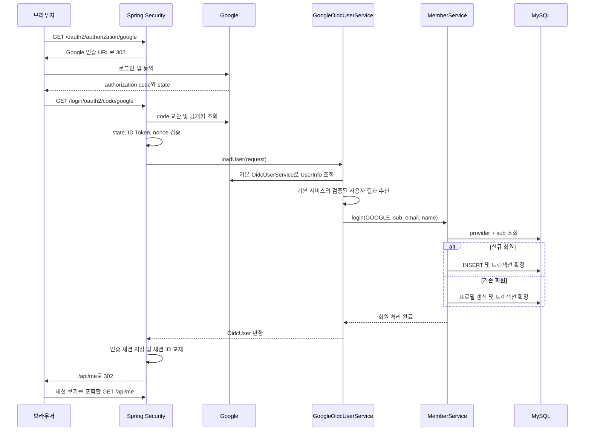

# Phase 1 기술 보고서 — Google OIDC 로그인과 회원 관리

작성일: 2026년 11월 2일 (Asia/Seoul)

현재 상태는 **Phase 1 구현 및 자동화 검증 완료, 실제 Google 계정 인수 검증 대기**입니다. H2와 실제 MySQL에서 각각 44개 테스트가 통과했으며, 실행 가능한 JAR를 직접 실행해 HTTP 응답도 확인했습니다. 실제 Google 동의 화면과 실계정 로그인은 수행하지 않았으므로, 아래 수동 검증을 마치기 전에는 실계정 로그인까지 확인되었다고 판단하시면 안 됩니다. 커밋과 Push는 수행하지 않았으며 Phase 2 기능도 구현하지 않았습니다.

## 1. 구현 목적

Google에서 로그인에 성공했다는 사실만으로는 서비스 안에서 회원을 일관되게 관리하기 어렵습니다. Google 계정과 내부 DB 회원을 연결해야 이후 API에서도 같은 사람을 식별할 수 있습니다. 따라서 이번 단계에서는 Google 인증 결과를 검증하는 역할은 Spring Security에 맡기고, 검증된 정보를 바탕으로 회원을 등록하거나 조회하는 로직을 구현했습니다.

회원 식별에는 `provider + providerId`를 사용하며, Google의 `sub`를 `providerId`에 저장합니다. 이메일과 이름은 재로그인 시 바뀔 수 있는 프로필 정보로 취급합니다. 예를 들어 이메일이 변경되더라도 Google `sub`가 같으면 기존 `memberId`를 유지하고, 반대로 이메일이 같더라도 `sub`가 다르면 서로 다른 회원으로 저장합니다. Google 공식 문서에서도 이메일 대신 `sub`를 고유 식별자로 사용하도록 안내합니다. [Google OIDC 문서](https://developers.google.com/identity/openid-connect/openid-connect)

## 2. 구현 범위 및 파일 구조

### 2.1 기존 프로젝트 분석과 유지한 사항

| 확인 항목 | 변경 전 상태 | 처리 내용 |
| --- | --- | --- |
| 빌드 환경 | Java 21, Boot 4.1.2, Gradle Wrapper 9.8.2였습니다. | 버전을 유지하고 실제 의존성 해석과 빌드로 확인했습니다. |
| 기존 의존성 | WebMVC, RestClient, Security, OAuth2 Client, Lombok, Devtools와 테스트 스타터가 있었습니다. | 기존 의존성을 유지하고 JPA·Flyway·DB 드라이버·보안 테스트 도구를 추가했습니다. |
| Google 설정 | Client ID와 Secret은 이미 환경변수였으며 scope는 `openid/profile/email`이었습니다. | 기존 Google 설정을 재사용했습니다. Calendar 권한이나 offline 접근은 추가하지 않았습니다. |
| SecurityConfig | Health만 공개하고 나머지는 인증을 요구하며 기본 OAuth 로그인을 사용했습니다. | 구조를 이어서 사용하면서 회원 저장 연결, JSON 오류 응답, 로그아웃을 추가했습니다. |
| AuthController | 작업 중인 파일이 있었고, 경로 없는 `@GetMapping`과 내부 `UserResponse`가 있었습니다. | `/api/me` 경로를 지정하고 DTO를 별도 파일로 이동했습니다. 기존 `subject/email/fullName` 필드는 유지했습니다. |
| ApiResponse | 작업 중인 제네릭 record에 `success/message/data`가 있었습니다. | 이 구조를 유지하고 실패 응답 생성 기능을 추가했습니다. |
| Health API | `GET /api/health`에 `{"status":"UP"}`를 반환했습니다. | 원본 파일과 응답을 그대로 유지하고 회귀 테스트를 추가했습니다. |
| 프로젝트 이름 | Gradle 프로젝트명과 애플리케이션명은 `booking-calendar-api`였습니다. | 이름을 유지했습니다. |
| Java 이름 | 패키지는 `org.example.github_api_practice`, 시작 클래스는 `GithubApiPracticeApplication`이었습니다. | 프로젝트명과 의미가 다르지만 실행에는 문제가 없어 이번 단계에서는 유지했습니다. |
| DB | JPA·MySQL 의존성, 회원 모델과 접속 설정이 없었습니다. | 회원 모델과 마이그레이션, 환경변수 기반 MySQL 설정을 추가했습니다. |

수정 전 Git 상태에는 사용자가 작성 중인 `AuthController`와 `ApiResponse`가 staged/unstaged 상태로 함께 존재했습니다. 이 코드를 이어서 구현했으며, 기존 index는 변경하지 않았습니다. 원본 파일과 staged/unstaged diff는 이번 작업 환경의 임시 폴더 `/private/tmp/booking-calendar-phase01-original`에 보관했습니다. 이 백업은 임시 자료이므로 영구 보관소로 보시면 안 됩니다.

### 2.2 주요 패키지

```text
org.example.github_api_practice
├── GithubApiPracticeApplication
├── HealthController
├── SecurityConfig
├── auth
│   ├── AuthController
│   ├── GoogleOidcUserService
│   └── dto
│       ├── UserResponse
│       └── CsrfResponse
├── member
│   ├── AuthProvider
│   ├── Member
│   ├── MemberRepository
│   └── MemberService
└── global
    ├── error
    │   ├── ErrorCode
    │   ├── ApiException
    │   └── GlobalExceptionHandler
    └── response
        ├── ApiResponse
        └── JsonResponseWriter
```

### 2.3 생성·수정한 파일과 책임

아래 Java 경로는 `src/main/java/org/example/github_api_practice/`를 기준으로 합니다.

| 파일 | 변경 | 책임 |
| --- | --- | --- |
| `SecurityConfig.java` | 수정 | 인증 경로, OIDC 사용자 서비스, API 인증 오류, 세션 기반 authorized client와 로그아웃을 설정합니다. |
| `auth/AuthController.java` | 기존 작업 이어서 수정 | 인증된 회원 조회와 CSRF 토큰 조회 요청을 받습니다. DB 저장 정책은 포함하지 않습니다. |
| `auth/GoogleOidcUserService.java` | 추가 | 기본 OIDC 사용자 서비스를 호출하고 검증된 사용자를 회원 서비스에 전달합니다. |
| `auth/dto/UserResponse.java` | 추가 | 내부 회원 ID와 기존 프로필 필드를 API에 전달합니다. 엔티티나 토큰을 직접 반환하지 않습니다. |
| `auth/dto/CsrfResponse.java` | 추가 | CSRF 헤더명과 요청 토큰을 전달합니다. |
| `member/AuthProvider.java` | 추가 | 지원하는 인증 제공자를 정의합니다. 현재 값은 `GOOGLE`뿐입니다. |
| `member/Member.java` | 추가 | DB 회원을 표현하고, 식별자를 유지하면서 프로필을 변경합니다. |
| `member/MemberRepository.java` | 추가 | 회원 저장과 `provider + providerId` 조회를 담당합니다. |
| `member/MemberService.java` | 추가 | 신규 등록, 재로그인 프로필 갱신, 중복 가입 경합 복구와 회원 조회를 처리합니다. |
| `global/error/ErrorCode.java` | 추가 | HTTP 상태와 공개 오류 메시지를 정의합니다. |
| `global/error/ApiException.java` | 추가 | 업무상 오류 코드를 예외로 전달합니다. |
| `global/error/GlobalExceptionHandler.java` | 추가 | MVC 영역의 업무 오류와 DB 오류, HTTP 오류를 공통 JSON으로 변환합니다. |
| `global/response/ApiResponse.java` | 기존 작업 이어서 수정 | `success/message/data` 형식의 성공·실패 응답을 생성합니다. 내부 `ErrorDetail`은 오류 코드를 전달합니다. |
| `global/response/JsonResponseWriter.java` | 추가 | MVC 이전의 Security 필터에서도 동일한 JSON 형식으로 응답하도록 직렬화합니다. |

설정·문서 파일은 다음과 같습니다.

| 파일 | 변경 내용 |
| --- | --- |
| `build.gradle` | JPA, Flyway, MySQL Connector/J, Flyway MySQL 지원, H2, Security 테스트 의존성을 추가했습니다. |
| `.gitignore` | `.env.*`를 제외하되 `.env.example`은 포함할 수 있게 했습니다. |
| `.env.example` | 실제 값이 없는 OAuth·DB·쿠키 설정 예시를 추가했습니다. |
| `src/main/resources/application.yml` | MySQL 접속, JPA 스키마 검증, UTC JDBC 설정, 세션·쿠키 설정을 추가했습니다. |
| `src/main/resources/db/migration/V1__create_members.sql` | 회원 테이블과 복합 UNIQUE 제약을 정의했습니다. |
| `src/test/resources/application-test.yml` | 테스트용 가짜 OAuth 설정과 H2 기본값, MySQL 테스트 접속 재정의를 제공합니다. |
| `README.md` | DB 생성, 환경변수 적용, 로그인·로그아웃 및 테스트 실행 절차를 작성했습니다. |
| `docs/phase-01-report.md` | 현재 보고서입니다. |

테스트 파일은 기존 `GithubApiPracticeApplicationTests.java`를 수정했고, `member/MemberIntegrationTests.java`, `member/MemberServiceTests.java`, `auth/ApiIntegrationTests.java`, `auth/GoogleOidcUserServiceTests.java`, `auth/OAuthLoginIntegrationTests.java`, `auth/MockGoogleServer.java`를 추가했습니다. 경로는 모두 `src/test/java/org/example/github_api_practice/` 아래입니다. 마지막 파일은 테스트용 Google 응답과 서명된 토큰을 제공하는 보조 서버입니다.

## 3. 핵심 기술과 개념

### 3.1 실제 버전과 Boot 4.1.2 호환성

공식 시스템 요구사항에서 Boot 4.1.2의 Java·Gradle 지원 범위를 확인했고, 이 프로젝트의 Java 21과 Gradle 9.8.2를 그대로 사용했습니다. 문서 확인에 그치지 않고 실제로 의존성을 해석하고 컴파일·테스트·JAR 실행까지 검증했습니다. [Spring Boot 시스템 요구사항](https://docs.spring.io/spring-boot/system-requirements.html)

| 구성 | 실제 확인한 버전 |
| --- | --- |
| Java | OpenJDK 21.0.12.1 |
| Spring Boot / Gradle Wrapper | 4.1.2 / 9.8.2 |
| Spring Framework / Spring Security | 7.0.10 / 7.1.2 |
| Hibernate ORM | 7.4.13.Final |
| Jackson Databind | 3.1.7 |
| Flyway / MySQL Connector/J | 12.4.0 / 9.7.0 |
| H2 / 실제 테스트 MySQL 서버 | 2.4.240 / 9.7.1 |
| JUnit Jupiter | 6.0.3 |

요청에 제시된 JUnit 5와 달리, 현재 Boot 의존성 관리가 선택한 실제 버전은 JUnit Jupiter 6.0.3입니다. 별도로 5.x를 강제하지 않았으며, 기존과 같은 Jupiter의 `@Test`, `@BeforeEach`, 매개변수화 테스트 방식으로 작성했습니다. 따라서 이 결과를 “JUnit 5.x에서 검증했다”고 표현하시면 안 됩니다.

새 의존성의 개별 버전을 임의로 지정하지 않고 기존 Boot 의존성 관리를 따랐습니다. Boot 4의 MVC 테스트 패키지인 `org.springframework.boot.webmvc.test.autoconfigure.AutoConfigureMockMvc`를 사용했으며, JSON 작성에는 Jackson 3의 `tools.jackson.databind.json.JsonMapper`를 사용했습니다. 기존 RestClient 스타터, Lombok 설정과 Modulith BOM은 유지했지만, 이번 구현에서 Calendar 호출이나 Modulith 구조를 도입하지는 않았습니다.

### 3.2 세션 로그인을 선택한 이유

현재는 브라우저가 이 서버에 Google 로그인을 요청하고 같은 서버의 API를 사용하는 구조입니다. 따라서 로그인 결과를 서버 세션에 저장하고 브라우저에는 `JSESSIONID` 쿠키를 전달하는 방식이 적합합니다. 자체 JWT 발급을 추가하면 만료, 재발급, 폐기 정책까지 구현해야 하지만 현재 요구사항에는 그런 추가 구성이 필요하지 않습니다.

세션은 안내 데스크가 보관하는 출입 기록과 비슷합니다. 브라우저는 회원 정보 전체를 들고 다니는 대신 조회 번호인 세션 쿠키를 보내고, 서버는 그 번호로 인증 상태를 확인합니다. 다만 서버를 재시작하면 세션이 사라지며 여러 서버에서 로그인 상태를 공유하려면 별도 구성이 필요합니다.

자체 API용 JWT를 발급하지 않는다는 뜻이지, OIDC에서 JWT를 전혀 사용하지 않는다는 뜻은 아닙니다. Google이 발급하는 ID Token은 JWT이며, Spring Security가 이 토큰을 검증하는 과정은 그대로 사용합니다.

### 3.3 OAuth2, OIDC와 최소 권한

OAuth2는 외부 자원에 대한 접근 권한을 다루는 틀이며, OIDC는 그 위에서 로그인한 사용자의 신원을 확인하는 계층입니다. `openid` scope가 있으므로 일반 OAuth2 사용자 서비스가 아닌 OIDC 사용자 서비스에 회원 저장 로직을 연결했습니다. [Spring Security OAuth2 Login 고급 설정](https://docs.spring.io/spring-security/reference/servlet/oauth2/login/advanced.html)

권한은 `openid`, `profile`, `email`만 사용합니다. ID Token 검증이나 authorization code 교환을 직접 재구현하지 않았으며, `state`, `nonce`, 토큰 서명·만료 및 UserInfo의 `sub` 일치 확인은 프레임워크에 맡겼습니다. 기본 `OidcUserService`가 사용자 정보를 반환한 이후에만 회원 서비스를 호출합니다.

Calendar 권한, `access_type=offline`, Refresh Token 발급 요청과 토큰 DB 저장은 추가하지 않았습니다. 로그인 과정에서 사용하는 authorized client는 `HttpSessionOAuth2AuthorizedClientRepository`에 저장하므로 서버 세션 안에 머무르며, 로그아웃으로 세션을 무효화하면 함께 제거됩니다. 회원 테이블과 API 응답에는 Access Token·Refresh Token·ID Token을 넣지 않았습니다.

### 3.4 엔티티와 DB 제약

| 필드 | DB 형태 | 의미 |
| --- | --- | --- |
| `id` | BIGINT, PK, AUTO_INCREMENT | 서비스 내부 회원 번호입니다. |
| `provider` | VARCHAR(20), NOT NULL | 현재는 문자열 `GOOGLE`을 저장합니다. |
| `provider_id` | VARCHAR(255), NOT NULL | Google `sub`를 변환하지 않고 저장합니다. |
| `email` | VARCHAR(320), NULL 허용 | 식별 기준이 아닌 변경 가능한 프로필입니다. |
| `full_name` | VARCHAR(255), NULL 허용 | 표시용 이름입니다. |

`@Entity`는 JPA가 관리할 객체라는 의미이며, `@Id`와 `@GeneratedValue(IDENTITY)`는 DB가 내부 ID를 생성하도록 합니다. `@Enumerated(STRING)`으로 enum 순서 대신 이름을 저장하고, `provider/providerId`는 일반 프로필 갱신에서 변경되지 않도록 설정했습니다.

`@UniqueConstraint`와 실제 Flyway SQL 모두에 `(provider, provider_id)` 복합 UNIQUE를 명시했습니다. 특히 DB 제약은 애플리케이션의 사전 조회를 통과한 동시 요청도 차단합니다. 이메일에는 UNIQUE를 적용하지 않았습니다. 이름이나 이메일이 없는 경우를 허용하되, `sub` 누락·공백과 저장 길이를 초과하는 값은 회원 서비스에서 거절합니다.

Google `sub`는 대소문자를 구분하는 값이므로 DB를 `utf8mb4_bin` collation으로 생성하는 절차를 제공합니다. 테스트에서도 `Subject`와 `subject`가 서로 다른 회원으로 저장되는지 확인했습니다. Flyway SQL은 DB 기본 collation을 따르므로, 사용자가 다른 기본 collation으로 DB를 생성하면 이 보장이 달라질 수 있습니다.

### 3.5 최초 로그인 경합과 트랜잭션

단순한 “조회 후 없으면 INSERT”는 두 요청이 동시에 조회했을 때 모두 신규 회원이라고 판단할 수 있습니다. 이를 막기 위해 먼저 DB의 UNIQUE 제약으로 최종 중복 저장을 차단하고, 중복으로 실패한 요청은 먼저 저장된 회원을 다시 조회합니다.

중요한 점은 실패한 INSERT와 같은 트랜잭션에서 복구 조회를 계속하지 않는 것입니다. 이미 실패한 트랜잭션은 rollback-only 상태이거나 JPA 영속성 컨텍스트를 계속 사용하기 어려울 수 있습니다. 따라서 `TransactionTemplate`이 실패한 작업을 롤백한 뒤, 별도의 `REQUIRES_NEW` 트랜잭션에서 확정된 회원을 조회합니다.

선언적 `@Transactional`을 별도 클래스로 나누는 방법도 가능하지만, 현재 규모에서는 짧은 로그인 처리의 시작·종료와 예외 포착 위치를 명확히 보여 주는 `TransactionTemplate`을 선택했습니다. 같은 클래스 내부 메서드 호출에 `@Transactional`만 붙이는 방법은 프록시를 거치지 않는 문제가 있어 선택하지 않았습니다. 복구 조회에서도 회원이 없다면 원래 예외를 다시 던지므로, 모든 무결성 오류를 가입 성공으로 감추지는 않습니다.

### 3.6 공통 응답, 상태 코드와 예외 처리

기존 `ApiResponse<T>`의 `success/message/data`를 유지했습니다. DTO는 응답 본문의 모양을 정의하며, `ResponseEntity`는 HTTP 상태와 헤더를 설정합니다. `@ResponseStatus`도 고정 상태를 지정할 수 있지만, 여기서는 성공 API의 기본 200과 오류별 `ResponseEntity`로 충분해 중복해서 사용하지 않았습니다.

```json
{
  "success": true,
  "message": "success",
  "data": {
    "memberId": 1,
    "provider": "GOOGLE",
    "subject": "google-sub",
    "email": "member@example.test",
    "fullName": "회원 이름"
  }
}
```

```json
{
  "success": false,
  "message": "로그인이 필요합니다.",
  "data": { "code": "UNAUTHENTICATED" }
}
```

| 상황 | 상태 | 코드 |
| --- | --- | --- |
| 인증되지 않은 API 요청 | 401 | `UNAUTHENTICATED` |
| 로그인 거절·유효하지 않은 인증 응답 | 401 | `OAUTH_LOGIN_FAILED` |
| 요청 권한 또는 CSRF 검증 실패 | 403 | `ACCESS_DENIED` |
| 인증된 식별자에 해당하는 DB 회원 없음 | 404 | `MEMBER_NOT_FOUND` |
| 복구하지 못한 일반 DB 무결성 충돌 | 409 | `DATA_CONFLICT` |
| DB 접근 또는 트랜잭션 시작 실패 | 503 | `DATABASE_UNAVAILABLE` |
| 존재하지 않는 경로·지원하지 않는 메서드 | 404 / 405 | `HTTP_404` / `HTTP_405` |
| 예상하지 못한 서버 오류 | 500 | `INTERNAL_ERROR` |

Security 필터에서 발생하는 인증 오류는 MVC의 `@RestControllerAdvice`로 처리할 수 없으므로 Security의 entry point·access denied handler·OAuth failure handler에서 `JsonResponseWriter`를 호출합니다. Controller 이후의 예외는 `GlobalExceptionHandler`가 처리합니다. 응답에는 예외 원문, SQL, 토큰을 포함하지 않으며, 직접 작성한 오류 로그도 예외 클래스명만 남깁니다.

Health 응답은 기존 사용 방식과 호환되도록 공통 DTO로 감싸지 않았습니다. 또한 기존 Health는 단순 생존 확인이며, DB 연결 상태까지 확인하는 readiness API가 아닙니다.

### 3.7 CSRF와 로그아웃

쿠키는 브라우저가 자동으로 전송하므로 다른 사이트에서 원치 않는 상태 변경 요청을 보내는 위험을 고려해야 합니다. 따라서 세션 인증에서 CSRF를 비활성화하지 않았습니다. 클라이언트는 `GET /api/csrf`로 받은 토큰을 `X-CSRF-TOKEN` 헤더에 넣어 `POST /api/logout`을 요청합니다.

로그아웃은 Controller에서 직접 세션을 지우지 않고 Spring Security의 `LogoutFilter`에 맡겼습니다. 세션과 보안 컨텍스트를 정리한 뒤 `JSESSIONID` 쿠키를 삭제하며, 성공 응답은 HTTP 200과 `ApiResponse.success(null)`입니다. GET 요청만으로는 로그아웃되지 않습니다. [Spring Security 로그아웃 문서](https://docs.spring.io/spring-security/reference/servlet/authentication/logout.html)

쿠키에는 HttpOnly와 SameSite=Lax를 설정했고 URL로 세션 ID가 전달되지 않도록 cookie tracking을 사용했습니다. Secure 기본값은 HTTP 로컬 개발용 `false`이며 HTTPS 배포에서는 반드시 `SESSION_COOKIE_SECURE=true`로 설정합니다. 로그인·로그아웃 이후에는 기존 CSRF 토큰을 재사용하지 말고 다시 조회해야 합니다.

## 4. 요청 및 데이터 흐름

### 4.1 Google 로그인



모든 Google 통신이 위 순서대로 항상 새로 발생하는 것은 아닙니다. 공개키 조회에는 프레임워크 캐시가 적용될 수 있으며, 다이어그램은 역할을 설명하기 위한 주요 흐름입니다. 회원 저장 트랜잭션은 Google 네트워크 호출을 마친 다음 시작하므로, Google 응답을 기다리는 동안 DB 트랜잭션을 장시간 유지하지 않습니다.

### 4.2 내 정보 조회

`SecurityFilterChain → AuthController.me → MemberService.findByIdentity → MemberRepository → MySQL → UserResponse → ApiResponse` 순서입니다. `@AuthenticationPrincipal`로 세션의 `OidcUser`를 받고, 그 사용자의 `sub`로 DB 회원을 조회합니다. URL 파라미터로 다른 회원의 ID를 받아 조회하는 방식이 아니므로 호출자가 임의의 회원 ID를 지정할 수 없습니다. 세션의 이전 프로필을 그대로 반환하지 않고 DB 값을 읽는 것도 이 경로의 특징입니다.

### 4.3 로그아웃

`GET /api/csrf → POST /api/logout + 세션 쿠키 + CSRF 헤더 → CsrfFilter → LogoutFilter → 세션 무효화·쿠키 삭제 → JSON 200` 순서입니다. 토큰이 없거나 잘못되면 403이며 기존 로그인 세션은 유지됩니다. 이 기능은 애플리케이션 로그아웃이며 Google 계정 전체의 로그아웃이나 권한 철회는 아닙니다.

## 5. 핵심 코드 분석

### 5.1 OIDC 사용자 처리

위치: [GoogleOidcUserService.loadUser](../src/main/java/org/example/github_api_practice/auth/GoogleOidcUserService.java)

입력은 `OidcUserRequest`이며 출력은 Spring Security가 세션에 사용할 `OidcUser`입니다. 먼저 등록 ID가 `google`인지 확인하고, 기본 서비스의 `loadUser`를 호출한 뒤 `getSubject/getEmail/getFullName`을 회원 서비스에 전달합니다. 회원 등록이 실패하면 사용자 객체를 성공 결과로 반환하지 않으므로, 회원 없는 인증 세션이 생성되지 않도록 합니다.

DB 접근 오류뿐 아니라 `CannotCreateTransactionException` 같은 트랜잭션 오류도 OAuth 인증 실패로 변환합니다. 실패 핸들러는 이를 503으로 응답하고, 사용자 거절이나 토큰 검증 오류는 401로 응답합니다. 서비스에서는 토큰이나 Secret을 추출해 별도로 저장하지 않습니다.

### 5.2 회원 등록과 재로그인

위치: [MemberService.login](../src/main/java/org/example/github_api_practice/member/MemberService.java)

```java
Member member = memberRepository.findByProviderAndProviderId(provider, providerId)
        .orElseGet(() -> memberRepository.saveAndFlush(
                new Member(provider, providerId, email, fullName)));
member.updateProfile(email, fullName);
return member;
```

입력은 제공자, `sub`, 이메일과 이름입니다. 저장 가능한 값인지 검사한 뒤 위 코드가 `TransactionTemplate` 안에서 실행됩니다. 조회 결과가 있으면 기존 회원을 사용하고 없으면 `saveAndFlush`로 INSERT를 DB에 반영합니다. `flush`는 SQL 실행을 앞당기는 것이며, 그 자체가 트랜잭션 commit을 의미하지는 않습니다.

기존 회원의 `updateProfile`은 영속 상태에서 실행되므로 JPA 변경 감지로 갱신됩니다. 객체를 반환했더라도 호출자가 결과를 받는 시점에는 템플릿의 commit이 끝나 있습니다. 중복 제약 오류가 발생하면 템플릿이 롤백을 마친 다음 `catch`로 넘어가고, 복구용 별도 트랜잭션에서 같은 식별자의 회원을 찾습니다.

`REQUIRES_NEW`는 바깥 트랜잭션이 있더라도 독립된 트랜잭션으로 회원 처리를 확정합니다. 현재 호출 지점은 OIDC 로그인뿐이며, 미래에 다른 업무 트랜잭션에서 이 메서드를 재사용할 때에는 바깥 작업이 롤백되어도 회원 저장은 유지된다는 의미를 고려해야 합니다.

### 5.3 회원 정보 응답

위치: [AuthController.me](../src/main/java/org/example/github_api_practice/auth/AuthController.java), [UserResponse.from](../src/main/java/org/example/github_api_practice/auth/dto/UserResponse.java)

Controller는 인증 사용자에서 식별자를 얻어 서비스를 호출하고 DTO를 반환하는 역할에 집중합니다. `UserResponse`는 `memberId/provider/subject/email/fullName`만 공개합니다. 엔티티를 그대로 직렬화하면 이후 필드 추가가 API에 영향을 줄 수 있으므로 DTO로 응답 범위를 고정했습니다. `MemberService.findByIdentity`에는 읽기 전용 트랜잭션을 사용하며, 회원이 없으면 명시적인 업무 예외를 발생시킵니다.

현재 제공자는 Google 하나이므로 Controller에서 `GOOGLE`을 사용합니다. 다른 제공자를 추가할 때에는 OIDC principal과 provider 매핑도 함께 바꾸어야 하며 enum 값만 추가해서는 안 됩니다.

### 5.4 DB 생성과 스키마 검증

위치: [V1__create_members.sql](../src/main/resources/db/migration/V1__create_members.sql), [application.yml](../src/main/resources/application.yml)

Flyway가 버전 1 마이그레이션으로 테이블을 생성하고 실행 이력을 관리합니다. Hibernate의 `ddl-auto`는 `validate`로 설정해 실행할 때마다 테이블을 임의 변경하지 않도록 했습니다. `update`보다 SQL 변경을 리뷰하기 쉽고, H2와 MySQL에서도 같은 마이그레이션을 검증할 수 있습니다. 다만 Hibernate의 스키마 검증만으로 모든 UNIQUE·인덱스를 보장한다고 볼 수는 없으므로 실제 중복 INSERT 테스트를 별도로 작성했습니다.

## 6. 문제와 해결 과정

### 6.1 실제 발견·수정한 문제

1. **404·405가 500으로 변환되었습니다.** 초기 전역 핸들러에서 `ErrorResponseException`과 일반 `Exception`만 처리했습니다. 그런데 존재하지 않는 정적 경로의 `NoResourceFoundException`과 메서드 오류의 `HttpRequestMethodNotSupportedException`은 같은 상속 계층이 아니어서 일반 500 처리로 흘렀습니다. 두 예외를 명시적으로 HTTP 오류 처리에 포함하고 원래 상태와 헤더를 보존하도록 수정했습니다. 해당 회귀 테스트가 최종 통과했습니다.
2. **세션 ID 변경 테스트가 처음에 실패했습니다.** 처음에는 세션 객체만 콜백에 넣고 브라우저가 보낸 유효한 세션 ID를 재현하지 않았습니다. 설치된 Spring Security 소스를 확인한 결과, 기존 세션 ID가 유효할 때 변경 전략이 적용되는 것을 확인했습니다. 콜백 요청에 유효한 세션 ID와 쿠키 기반 요청 정보를 넣은 뒤 기본 보호 전략으로 ID가 바뀌는지 확인했습니다. 이것은 실제 운영 취약점을 발견한 사례가 아니라 테스트 구성 오류를 바로잡은 사례입니다.
3. **인증 실패 핸들러에서 컴파일 오류가 발생했습니다.** 실패 핸들러가 받는 타입은 일반 `AuthenticationException`이므로 `getError()`를 바로 호출할 수 없었습니다. `instanceof OAuth2AuthenticationException`으로 타입을 확인한 뒤 OAuth 오류 코드를 읽도록 수정했습니다.
4. **테스트의 JSON 문자열 이스케이프가 잘못되었습니다.** Health 응답 검증 코드를 Java text block으로 고쳐 컴파일 오류를 해결했습니다. 런타임 기능 오류와 구분되는 테스트 코드 작성 오류입니다.
5. **테스트 실행에 환경 제약이 있었습니다.** 최초 Gradle 실행은 사용자 캐시 접근 제한으로 실패해 필요한 실행 권한으로 재실행했습니다. Docker 데몬은 실행 중이 아니었으며, 로컬 MySQL 초기화도 최초 제한 환경에서 종료되었습니다. 기존 DB를 수정하는 대신 임시 디렉터리와 별도 로컬 포트를 사용하는 MySQL을 초기화해 검증했습니다. 검증 후 임시 서버와 JAR 프로세스는 종료했습니다.

### 6.2 설계 과정에서 예방한 위험

동시 가입 시 중복 INSERT, 실패한 트랜잭션 재사용, DB 연결 실패 시 인증 세션 생성, 토큰의 응답 노출 가능성을 검토하고 방어 로직과 테스트를 추가했습니다. 이 항목은 실제 운영 중 장애를 겪고 해결한 사례가 아니라 이번 구현에서 고려하고 검증한 위험입니다. 특히 DB 트랜잭션 시작 실패는 `DataAccessException`만으로 처리되지 않을 수 있어 `TransactionException`도 명시적으로 처리했습니다.

## 7. 테스트 및 검증 결과

### 7.1 실행 결과

최종 집계는 Gradle의 JUnit XML 결과를 읽어 확인했습니다. H2와 MySQL에서 각각 **44개 실행, 실패 0, 오류 0, 건너뜀 0**입니다. 신규 기능에 대한 검증이며, 향후 예약이나 Calendar 장애 대응을 검증한 결과는 아닙니다.

| 테스트 클래스 | 실행 수 | 검증 범위 |
| --- | ---: | --- |
| `GithubApiPracticeApplicationTests` | 1 | 테스트 프로필에서 전체 컨텍스트와 Flyway·JPA·Security 구동을 확인했습니다. |
| `MemberIntegrationTests` | 14 | 신규 등록, 재로그인·프로필 변경, 동일 이메일의 다른 sub, sub 대소문자 구분, 선택 프로필 누락, UNIQUE·NOT NULL, 유효하지 않은 sub 4건, 길이 초과, 없는 회원, 동시 최초 가입을 검증했습니다. |
| `MemberServiceTests` | 2 | 중복 INSERT 롤백 후 새 트랜잭션 조회 순서와 무관한 무결성 오류를 성공으로 숨기지 않는지 검증했습니다. |
| `GoogleOidcUserServiceTests` | 4 | 검증된 프로필 전달, 다른 제공자 차단, 잘못된 프로필 거절, UserInfo 처리 실패 시 저장하지 않는지 검증했습니다. |
| `ApiIntegrationTests` | 13 | Health, 비인증 401, DB 기반 내 정보, 회원 없음, DB·트랜잭션 오류, CSRF 누락·오류, 실제 CSRF 토큰 로그아웃, GET 로그아웃 방지, 공개 CSRF 조회, 404·405를 검증했습니다. |
| `OAuthLoginIntegrationTests` | 10 | 최소 scope, 신규 로그인·재로그인·세션 ID 교체, 동의 거절, state·nonce·만료·UserInfo sub 오류, token endpoint 오류, DB 접근·트랜잭션 시작 실패를 검증했습니다. |
| **합계** | **44** | H2와 실제 MySQL에서 각각 동일하게 통과했습니다. |

동시 가입 테스트는 8개 스레드를 준비한 뒤 동시에 같은 Google `sub`로 로그인 서비스를 호출합니다. 모든 요청이 동일한 내부 회원 ID를 반환하고 DB에는 한 행만 남는지 검사합니다. 별도의 단위 테스트는 중복 예외를 강제로 발생시켜 롤백 이후 새 트랜잭션을 여는 순서까지 검증합니다. 단 한 번의 동시성 테스트로 모든 부하 상황을 증명한 것은 아니지만, 중복 가입 방어의 핵심 경로를 두 방식으로 검증했습니다.

OAuth 통합 테스트는 인증 상태만 주입하는 `oidcLogin()`에 의존하지 않습니다. 로컬 HTTP 모의 서버에서 token endpoint, JWKS, UserInfo를 제공하고, 테스트용 RSA 키로 서명한 ID Token을 실제 Security 콜백 필터에 전달합니다. 따라서 실제 토큰 교환 경로·서명 검증·회원 저장·세션 저장을 함께 확인합니다. 다만 Google의 실제 인증 서버와 동의 화면을 사용한 검증은 아닙니다. 일반 API 테스트에서는 관심 범위가 Controller와 접근 제어이므로 `oidcLogin()`도 함께 사용했습니다.

### 7.2 실행 명령

기본 H2 테스트와 JAR 빌드는 다음 명령으로 성공했습니다.

```sh
./gradlew clean test bootJar --no-daemon
```

실제 MySQL 테스트에는 이번 작업에서 새로 만든 일회용 테스트 DB를 사용했습니다. 설치된 MySQL 9.7.1을 `/private/tmp/booking-calendar-mysql-phase01/data-retry`와 로컬 포트 `13316`에서 실행했으며 Docker는 사용하지 않았습니다. 접속 값은 테스트 전용이며, 기존 사용자 DB는 연결하거나 변경하지 않았습니다.

```sh
TEST_DB_URL='jdbc:mysql://127.0.0.1:13316/booking_phase01_test?connectionTimeZone=UTC&forceConnectionTimeZoneToSession=true' \
TEST_DB_USERNAME=phase01_test \
TEST_DB_PASSWORD=phase01-test-only \
./gradlew cleanTest test --no-daemon
```

위 서버는 검증 후 종료했으므로 재실행 시에는 별도의 테스트 DB를 준비하고 접속 값을 바꾸셔야 합니다. 기본 테스트 프로필의 URL은 H2이며, 실제 DB 테스트에 사용할 때만 `TEST_DB_*`를 지정합니다. 테스트 준비 과정에서 회원 데이터를 삭제하므로 운영 DB나 사용자 데이터가 있는 DB를 지정하시면 안 됩니다. 환경변수에 따른 실행 환경 변경이 Gradle의 이전 테스트 결과 재사용에 영향을 받지 않도록 명령에 `cleanTest`를 포함했습니다.

의존성 확인에는 `./gradlew dependencies --configuration testRuntimeClasspath --no-daemon`을 사용했습니다. 공백 오류는 `git diff --check`로 확인했고, 기존 staged diff가 변경되지 않은 것도 원본 백업과 비교했습니다. `.env`와 `.env.local`은 Git 제외 대상이며 `.env.example`은 포함 가능한 상태입니다.

Gradle 테스트 HTML은 `build/reports/tests/test/index.html`에 있으며 마지막 전체 실행 결과는 MySQL입니다. XML은 `build/test-results/test/`에 생성됩니다. 이 파일들은 재실행하면 덮어써지며 Git에는 포함하지 않습니다.

### 7.3 실제 JAR HTTP 확인

빌드한 `build/libs/booking-calendar-api-0.0.1-SNAPSHOT.jar`를 테스트 전용 MySQL과 연결하고 로컬 포트 `18086`에서 실행했습니다. 이때 실제 Google 자격증명 대신 외부 로그인을 하지 않는 smoke test용 더미 값을 사용했습니다.

| 실제 HTTP 요청 | 확인 결과 |
| --- | --- |
| `GET /api/health` | 200, 기존 `{"status":"UP"}` 응답을 확인했습니다. |
| 비인증 `GET /api/me` | 401, `UNAUTHENTICATED` JSON을 확인했습니다. |
| `GET /api/csrf` | 200, CSRF 토큰과 세션 쿠키의 HttpOnly·SameSite=Lax를 확인했습니다. |
| CSRF 없는 `POST /api/logout` | 403을 확인했습니다. |
| 실제 발급된 CSRF를 보낸 `POST /api/logout` | 익명 세션에서 200 응답을 확인했습니다. 인증된 세션의 무효화는 별도 자동화 테스트에서 검증했습니다. |

JVM의 class sharing 경고는 표시되었으나 테스트와 JAR 빌드는 성공했습니다. 성공 기준에 경고를 오류처럼 포함하거나, 실패한 중간 실행을 최종 성공 결과에 섞지 않았습니다.

### 7.4 실제 Google 계정 수동 검증 절차

아래 항목은 **아직 실행하지 않았습니다.** [README의 로컬 실행 절차](../README.md)에 따라 별도의 개발 DB와 실제 환경변수를 준비한 뒤 확인해 주세요.

1. MySQL에 `utf8mb4_bin` collation을 사용하는 개발 DB와 계정을 만들고 `.env.example`을 참고해 `.env` 또는 IDE 환경변수를 등록합니다. `.env`는 Boot가 자동으로 읽지 않으므로 셸에서 export하거나 IDE에 지정해야 합니다.
2. Google Cloud Console의 웹 OAuth Client에 `http://localhost:8080/login/oauth2/code/google`을 정확히 등록합니다. 동의 화면의 게시 상태와 테스트 사용자 설정도 확인합니다.
3. `./gradlew bootRun`으로 시작한 뒤 로그에 Flyway와 JPA 검증 실패가 없는지 확인합니다. 자격증명과 토큰을 화면 공유나 로그에 복사하지 않습니다.
4. 로그인 전 `GET /api/health`가 200이고 `/api/me`가 401인지 확인합니다.
5. 브라우저에서 `http://localhost:8080/oauth2/authorization/google`에 접속해 Google 로그인을 진행합니다. Calendar 권한이 추가 요청되지 않는지 확인합니다.
6. 콜백 이후 `/api/me`에서 `success=true`, 내부 `memberId`, `subject`, 이메일과 이름이 반환되는지 확인합니다. DB에서는 아래 조회로 회원 행을 확인합니다.

   ```sql
   SELECT id, provider, provider_id, email, full_name FROM members;
   SELECT provider, provider_id, COUNT(*)
   FROM members
   GROUP BY provider, provider_id
   HAVING COUNT(*) > 1;
   ```

7. [README의 로그아웃 코드](../README.md#로그아웃)로 로그아웃하고 `/api/me`가 401인지 확인합니다. 같은 계정으로 다시 로그인했을 때 내부 `memberId`가 유지되고 회원 행이 늘지 않아야 합니다.
8. 로그인 동의를 거절해 오류 응답이 처리되는지도 확인합니다. 테스트 화면에 실제 Secret이나 토큰을 기록하지 않습니다.
9. HTTPS 환경에서는 `SESSION_COOKIE_SECURE=true`를 지정하고 브라우저에서 Secure·HttpOnly·SameSite 쿠키 속성을 확인합니다. 이 배포 검증은 이번 로컬 테스트에 포함되지 않았습니다.

### 7.5 검증하지 못한 사항과 남은 위험

실계정 로그인과 Google Cloud 프로젝트 설정은 아직 검증하지 않았습니다. 실제 사용자의 이름 변경 반영은 Google 측 전파 상황까지 포함해 확인하지 않았으며, 테스트에서는 바뀐 claim이 전달되었을 때 DB가 갱신되는 것까지만 확인했습니다. MySQL 검증 버전은 9.7.1이며 다른 버전과 실제 배포 환경에서도 같은 테스트를 재실행하는 것이 좋습니다.

현재는 단일 서버의 메모리 세션이며 HTTPS 배포·리버스 프록시·다중 서버의 세션 공유는 검증하지 않았습니다. 또한 이름이나 이메일이 255자·320자를 넘으면 로그인 오류로 처리하는 현재 정책을 유지할지 검토할 수 있습니다. 프로필 claim이 누락된 재로그인에서는 해당 필드가 null로 갱신됩니다.

## 8. 코드 리뷰 및 학습 포인트

코드는 [SecurityConfig](../src/main/java/org/example/github_api_practice/SecurityConfig.java), [GoogleOidcUserService](../src/main/java/org/example/github_api_practice/auth/GoogleOidcUserService.java), [MemberService](../src/main/java/org/example/github_api_practice/member/MemberService.java), [Member](../src/main/java/org/example/github_api_practice/member/Member.java), [AuthController](../src/main/java/org/example/github_api_practice/auth/AuthController.java) 순서로 읽으시면 로그인 흐름을 따라가기 쉽습니다. 이후 오류 처리와 테스트를 보면서 경계 조건을 확인하시면 됩니다.

| 면접·리뷰 질문 | 설명해야 할 핵심 |
| --- | --- |
| 왜 이메일을 회원 키로 쓰지 않았나요? | 변경 가능한 프로필과 안정된 외부 식별자를 구분하고 provider와 sub를 함께 사용했다는 점입니다. |
| 세션 방식을 선택한 이유는 무엇인가요? | 현재 브라우저 로그인 구조에서 서버가 세션을 폐기하는 것으로 로그아웃을 처리할 수 있으며, 자체 JWT 재발급·폐기까지 추가할 필요가 없었다는 점입니다. |
| 조회 후 INSERT만으로 중복이 막히나요? | 두 요청이 모두 “없음”을 볼 수 있으므로 DB UNIQUE가 최종 방어선이라는 점입니다. |
| 중복 예외를 같은 트랜잭션에서 잡고 조회하면 안 되나요? | 실패한 트랜잭션과 영속성 컨텍스트를 재사용하지 않고 롤백 이후 확정된 데이터를 다시 읽는다는 점입니다. |
| `saveAndFlush`와 commit의 차이는 무엇인가요? | SQL 실행 시점과 트랜잭션 확정 시점을 구분해야 한다는 점입니다. |
| 재로그인 때 `save`를 또 호출하지 않는 이유는 무엇인가요? | 트랜잭션 안에서 조회한 영속 엔티티의 변경 감지를 사용하기 때문입니다. |
| 왜 Security 오류를 Advice 하나로 처리하지 않았나요? | 필터와 MVC가 실행되는 위치가 다르기 때문입니다. |
| CSRF 토큰과 OAuth state는 같은가요? | 둘 다 요청 위조 방어와 관련되지만 일반 상태 변경 API와 OAuth 인증 왕복이라는 적용 흐름이 다릅니다. |
| `oidcLogin()` 테스트만으로 로그인 구현을 증명할 수 있나요? | 인증된 요청 처리는 확인할 수 있지만 실제 콜백·회원 저장 연결은 별도 테스트가 필요하다는 점입니다. |

개선 가능한 부분으로는 패키지·시작 클래스 이름 정리, 다중 서버를 위한 세션 공유, DB migration 전용 계정과 실행 계정 분리, 배포 환경의 쿠키 설정 검증이 있습니다. 이런 항목은 현재 코드가 동작하지 않는 이유가 아니라 운영 범위가 커질 때 검토할 사항입니다. 회원 조회와 로그인 저장의 트랜잭션 경계, DB 기본 collation, 지원 제공자가 Google 하나라는 가정은 코드를 재사용하기 전에 반드시 확인해 주세요.

## 9. 블로그 작성용 요약

추천 제목은 **“Spring Boot 4.1에서 Google OIDC 로그인과 회원 저장 구현하기”**입니다. 블로그 본문은 작성하지 않았으며 아래 구성을 활용하실 수 있습니다.

1. 기본 OAuth 설정만 있는 프로젝트에서 서비스 회원 관리가 필요한 이유를 설명합니다.
2. Google `sub`와 내부 `memberId`, 이메일의 역할을 구분합니다.
3. 세션과 JWT를 비교하고 현재 범위에서 세션을 선택한 근거를 설명합니다.
4. 기본 OIDC 사용자 서비스 뒤에 회원 저장을 연결하고 `/api/me`까지 이어지는 요청 흐름을 설명합니다.
5. UNIQUE 제약과 독립된 복구 트랜잭션으로 동시 최초 가입을 처리하는 과정을 설명합니다.
6. 필터와 MVC의 오류 처리 위치, CSRF를 유지한 로그아웃을 설명합니다.
7. H2·실제 MySQL·로컬 모의 OIDC 서버에서 검증한 범위와 실계정 수동 검증의 차이를 정리합니다.

실제 문제 해결 사례로는 404·405가 일반 500 처리로 바뀐 원인, MockMvc의 유효한 세션 ID 설정 누락으로 세션 보호 검증이 실패한 원인을 사용할 수 있습니다. 반면 동시 가입 방어는 구현과 테스트로 확인한 설계 사례이며 실제 운영 장애를 해결한 경험처럼 작성하시면 안 됩니다. 버전 설명에서도 JUnit 5가 아니라 실제 실행한 Jupiter 6.0.3을 밝혀 주세요.

회고에서는 “프레임워크의 인증 검증을 직접 구현하기보다 확장 지점을 이해하는 것이 중요했습니다”, “사전 조회와 DB 제약의 책임이 다르다는 것을 테스트로 확인했습니다”, “테스트가 실패했을 때 애플리케이션과 테스트 환경 양쪽을 확인해야 했습니다”라는 실제 학습 경험을 중심으로 정리하실 수 있습니다.

## 10. 다음 단계 준비 사항

회원 PK와 세션 인증, `ApiResponse`, 전역 오류 처리, MySQL 설정과 Flyway 마이그레이션은 다음 단계에서 재사용할 수 있습니다. 예약 기능이 필요해지면 인증된 회원과 예약 소유자를 연결해야 하지만, 현재는 예약 엔티티·API·동시성 제어를 추가하지 않았습니다.

Google Calendar scope, Access Token·Refresh Token의 안전한 영속 관리와 외부 API 호출도 이번 범위에 포함하지 않았습니다. 이들은 로그인 인증과 Calendar 접근 권한의 차이를 검토한 뒤 해당 단계에서 설계해야 합니다.

우선 사용자가 Phase 1 코드와 보고서를 검토하고 실제 Google 수동 검증을 진행하셔야 합니다. 수정 요청을 반영한 뒤 커밋 승인을 받으면 아래 범위만 커밋할 예정입니다.

- Phase 1 인증·회원·DTO·예외 처리 코드
- DB 마이그레이션과 환경설정 예시 및 Git 제외 규칙
- Phase 1 테스트, README와 현재 기술 보고서

추천 커밋 메시지는 `feat: 구글 OAuth 로그인 및 회원 관리 구현`입니다. 현재는 커밋·Push를 하지 않았으며, 다음 단계 진행도 중단한 상태입니다.
